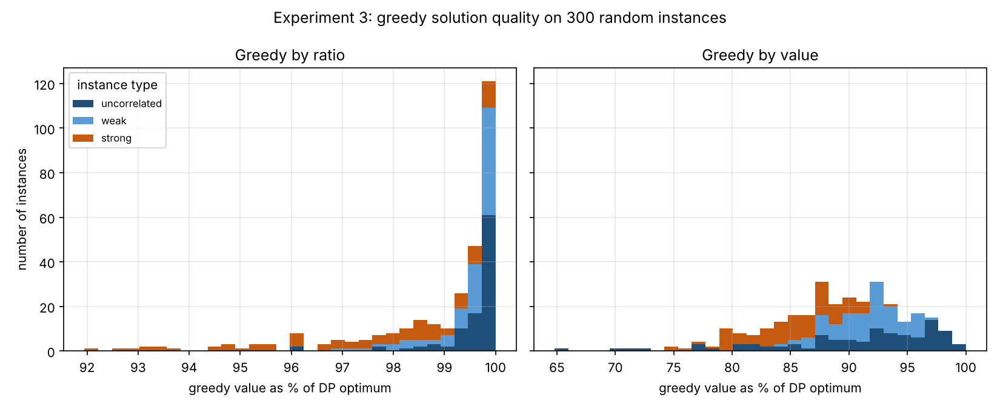
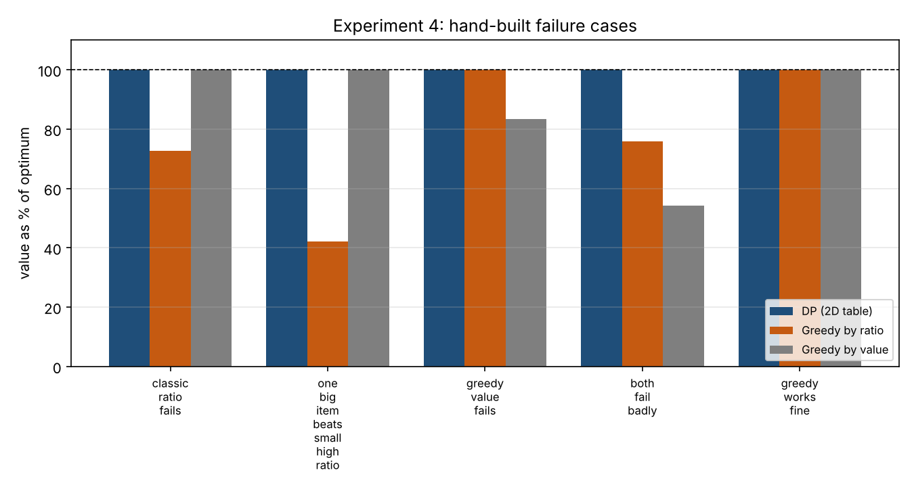

# Report outline

**When Does Greedy Fail? Comparing Dynamic Programming and Greedy Algorithms for the Knapsack Problem**

CS 4306 Algorithm Analysis, Kennesaw State University, Fall 2026
Jonathan Brockob, Ramon Mandujano, Alex Rivera Figueroa, Ocean Tshimbalanga
Professor: Dr. Femi Ojo

Every `[TODO: ...]` below is a placeholder. The numbers come from
`results/summary.md` after running `python experiments/run_all.py`; the
charts are in `results/charts/`.

---

## 1. Problem Statement

- Define the 0/1 knapsack problem: n items, item i has value v_i and weight w_i,
  capacity W, choose a subset maximizing total value with total weight <= W.
- Why it matters: resource allocation, budgeting, cargo loading, cutting stock.
- The question we answer: when is the fast greedy heuristic good enough, and
  when does it fail? What does the exact DP cost in time and memory to get the
  guarantee?
- [TODO: one paragraph, cite the textbook definition]

## 2. Background

The 0/1 knapsack problem selects items with values $v_i$ and weights $w_i$
to maximize total value without exceeding capacity $W$. Each item must be
selected completely or excluded. Its mathematical formulation is

$$
\max \sum_{i=1}^{n} v_i x_i
\quad\text{subject to}\quad
\sum_{i=1}^{n} w_i x_i \le W,\qquad x_i\in\{0,1\}.
$$

The optimization problem is NP-hard. For integer weights and capacity, the
standard dynamic programming algorithm solves it exactly in $O(nW)$ time.
This is pseudo-polynomial because the running time depends on the numerical
value of $W$, while representing $W$ in binary requires only $O(\log W)$
bits. A capacity that takes relatively few bits to represent can therefore
still require a very large table [1]. Our full-table implementation stores
$O(nW)$ entries and recovers the selected items. The rolling-array version
uses $O(W)$ space and returns only the optimal value.

We compare DP with two greedy heuristics. Greedy by ratio processes items in
decreasing order of value per unit of weight, $v_i/w_i$. Greedy by value
processes items in decreasing order of value alone. Both accept an item
whenever it fits and continue checking subsequent items when one does not
fit. Sorting gives these implementations an $O(n\log n)$ worst-case running
time, but neither guarantees an optimal 0/1 solution. The implementations
are in [algorithms.py](../knapsack/algorithms.py).

The distinction between 0/1 and fractional knapsack explains why ratio-based
greedy can fail. Fractional knapsack allows part of an item to be selected.
Taking available weight from the highest-value-density items is optimal:
a lower-density portion can be exchanged for an equal weight of a
higher-density item without reducing value [2]. In 0/1 knapsack, that
exchange may require splitting an item, which is prohibited. An initially
attractive item can therefore prevent a better combination from fitting.

Instance structure also affects performance. Pisinger describes benchmark
families with independent values and weights, values close to weights, and
values equal to weights plus a fixed constant [3]. Our project uses versions
of these uncorrelated, weakly correlated, and strongly correlated families
to examine how value-weight relationships affect greedy solution quality.

## 3. Methodology

- Implementation: Python 3, package `knapsack/`.
  - `dp_01_knapsack`: 2D table (n+1) x (W+1) with backtracking.
  - `dp_01_knapsack_1d`: rolling array of size W+1 (value only).
  - `greedy_by_ratio`, `greedy_by_value`: sort then one pass.
  - `brute_force` as the test oracle for n <= 12.
- Measurement (`knapsack/metrics.py`): wall time with `time.perf_counter`,
  median of 3 runs; peak memory with `tracemalloc` in a separate run.
- Instance generation (`knapsack/instance.py`): fixed seeds for
  reproducibility, values and weights in [1, 100] unless stated.
- Testing: 815 pytest cases (DP = brute force on 200 random instances,
  greedy <= DP, feasibility, 1D = 2D, failure cases).
- Hardware used for the reported numbers: [TODO: CPU, RAM, Python version, OS]

## 4. Evaluation

### Experiment 1: fixed capacity, growing n (`results/exp1_items.csv`)

- Setup: W = 1000, n in {10, 20, 50, 100, 200, 500, 1000, 2000}.
- Figure: `results/charts/exp1_runtime_vs_n.png` (log-log, with O(nW) and
  O(n log n) reference lines) and `results/charts/exp1_memory_vs_n.png`.
- [TODO: DP runtime at n = 2000, greedy runtime at n = 2000, ratio between them]
- [TODO: comment on the slope of each curve on the log-log plot]

### Experiment 2: fixed n, growing capacity (`results/exp2_capacity.csv`)

- Setup: n = 200, W in {100, 200, 500, 1000, 2000, 5000, 10000, 20000, 50000}.
- Figure: `results/charts/exp2_runtime_vs_capacity.png` and
  `results/charts/exp2_memory_vs_capacity.png`.
- [TODO: DP 2D runtime and memory at W = 50000; 1D memory at W = 50000;
  greedy runtime, which should be flat]
- Point to make: greedy does not depend on W at all; DP cost is driven by W.

### Experiment 3: solution quality (`results/exp3_quality.csv`, `results/exp3_quality_summary.csv`)

We evaluated 300 randomly generated instances, consisting of 100 instances
from each correlation family. Each instance contained between 20 and 100
items. Capacity was obtained by rounding down a randomly selected 20% to
60% of the total item weight. The experiment used master seed 4306, allowing
the same instances to be regenerated. For each instance, the two-dimensional
DP solver supplied the optimal value used to evaluate both greedy heuristics.
These settings are defined in [exp3_quality.py](../experiments/exp3_quality.py).

Weights were sampled uniformly from 1 through 100. Uncorrelated values were
independently sampled from the same range. Weakly correlated values were
generated as $\max(1,w_i+\delta_i)$, where $\delta_i$ was an integer sampled
uniformly from -10 through 10. Strongly correlated values were $w_i+10$.
Consequently, correlated values could exceed 100 and reach 110. These are
the actual settings of the [instance generator](../knapsack/instance.py).

Solution quality was measured as $100(V_{\text{greedy}}/V_{\text{optimal}})$.
The table reports the arithmetic mean and minimum of these percentages,
together with the percentage of instances solved optimally.

| Heuristic | Instance family | Instances | Mean quality | Minimum quality | Exactly optimal |
|---|---|---:|---:|---:|---:|
| Ratio | Uncorrelated | 100 | 99.614% | 96.066% | 36.0% |
| Ratio | Weakly correlated | 100 | 99.459% | 96.993% | 17.0% |
| Ratio | Strongly correlated | 100 | 97.598% | 91.948% | 3.0% |
| **Ratio** | **All** | **300** | **98.890%** | **91.948%** | **18.7%** |
| Value | Uncorrelated | 100 | 90.783% | 64.812% | 1.0% |
| Value | Weakly correlated | 100 | 91.497% | 84.301% | 0.0% |
| Value | Strongly correlated | 100 | 85.128% | 74.866% | 0.0% |
| **Value** | **All** | **300** | **89.136%** | **64.812%** | **0.3%** |

Source: [Experiment 3 summary data](../results/exp3_quality_summary.csv).

*Experiment 3: Greedy solution quality as a percentage of the DP optimum.
Each panel contains 300 instances, grouped by correlation family.*

Greedy by ratio achieved substantially better average quality across all
three families. Its overall mean shortfall was approximately 1.110%,
compared with 10.864% for greedy by value. However, high average quality did
not imply frequent exact optimality: ratio greedy matched DP on only 56 of
300 instances, while value greedy matched it on one. These counts are
confirmed by the [individual results](../results/exp3_quality.csv).

Strongly correlated instances produced the lowest mean quality for both
heuristics. The generator provides a useful explanation: because
$v_i=w_i+10$, the ratio is $1+10/w_i$, so ratio greedy orders items from
lightest to heaviest. For any selected set, total value equals its total
weight plus ten times its item count. Choosing small items favors the
item-count bonus, but can leave unused capacity that a different combination
would use more effectively. Conversely, value greedy favors heavier items
and can sacrifice too many item-count bonuses. This is an interpretation
of the generator and observed results, rather than proof that strongly
correlated instances are always hardest.

The results support ratio greedy as a promising heuristic for these sampled
instances. They do not establish a universal approximation guarantee: the
observed minimum describes this sample, and other inputs can produce much
larger losses. Experiment 4 investigates that limitation directly.

### Experiment 4: hand-built failure cases (`results/exp4_failure_cases.csv`)

We examined four counterexamples and one control case to identify how
individual greedy choices affect the final solution. All item pairs below
use **(value, weight)**. The percentage gap is

$$
100\frac{V_{\text{optimal}}-V_{\text{greedy}}}{V_{\text{optimal}}}.
$$

| Case | Capacity | DP optimum | Ratio value | Ratio gap | Value heuristic result | Value gap |
|---|---:|---:|---:|---:|---:|---:|
| Classic ratio failure | 50 | 220 | 160 | 27.27% | 220 | 0.00% |
| One large item beats small items | 100 | 95 | 40 | 57.89% | 95 | 0.00% |
| Value ordering fails | 10 | 12 | 12 | 0.00% | 10 | 16.67% |
| Both heuristics fail | 100 | 120 | 91 | 24.17% | 65 | 45.83% |
| Control case | 12 | 21 | 21 | 0.00% | 21 | 0.00% |

Source: [Experiment 4 results](../results/exp4_failure_cases.csv). The instances
are defined in [exp4_failure_cases.py](../experiments/exp4_failure_cases.py).

*Experiment 4: Relative solution values for the four counterexamples and
the control case. DP reaches 100% in every case.*

1. **Classic ratio failure.** With capacity 50 and items $(60,10)$,
   $(100,20)$, and $(120,30)$, ratio greedy selects the first two items
   because their ratios are 6 and 5. This yields value 160 and leaves 20
   units unused; the remaining item weighs 30. DP and value greedy select
   the latter two items, achieving value 220. The initial high-ratio choice
   blocks the better pair.

2. **One large item beats small items.** With capacity 100, the items are
   $(95,100)$ and four copies of $(10,6)$. Ratio greedy selects all four
   small items, producing value 40 and leaving 76 units unused. The large
   item no longer fits. DP and value greedy choose it alone for value 95.
   This produces ratio greedy's largest gap among these five cases: 57.89%.

3. **Value ordering fails.** With capacity 10 and items $(10,10)$, $(6,5)$,
   and $(6,5)$, value greedy selects the individually most valuable item
   and fills the bag for value 10. Ratio greedy and DP select both smaller
   items for value 12. Filling the capacity completely therefore does not
   establish optimality.

4. **Both heuristics fail.** With capacity 100 and items $(60,50)$,
   $(60,50)$, $(31,20)$, and $(65,100)$, ratio greedy first selects
   $(31,20)$, then one $(60,50)$, obtaining 91. Value greedy selects
   $(65,100)$, obtaining 65. DP instead selects both $(60,50)$ items for
   120. Choosing the better of the two greedy answers would still miss
   the optimum.

5. **Control case.** With capacity 12 and items $(10,5)$, $(7,4)$,
   $(4,3)$, $(3,2)$, and $(1,1)$, all algorithms obtain 21. DP and value
   greedy select the first three items. Ratio greedy selects $(10,5)$,
   $(7,4)$, $(3,2)$, and $(1,1)$. Different subsets can therefore achieve
   the same optimal value.

Together, the experiments show that ratio greedy can perform well on
average while still suffering substantial losses on particular inputs.
Its limitation is the commitment to locally attractive items without
reconsidering the combinations they exclude. DP provides the optimal-value
guarantee that both tested greedy heuristics lack.

## 5. Results

- Summarize the four experiments in one table and 3 or 4 sentences each.
- [TODO: paste the headline numbers from `results/summary.md`]
- Observation: greedy-by-ratio is close to optimal on average but is rarely
  exactly optimal; greedy-by-value is much worse.
- Observation: the DP memory problem is solved by the 1D array, the time
  problem is not.

## 6. Complexity Analysis

- Theoretical: DP O(nW) time, O(nW) or O(W) space; greedy O(n log n) time,
  O(n) space; brute force O(2^n).
- Measured growth vs theory:
  - Experiment 1 (W fixed): fit the slope of log(time) vs log(n). DP should be
    close to 1 (linear in n since W is constant); greedy slightly above 1
    (n log n). Measured: DP (2D) 1.02, greedy-by-ratio 1.04.
  - Experiment 2 (n fixed): DP slope vs log(W) should be close to 1; greedy
    slope close to 0. Measured: DP (2D) 1.12, greedy-by-ratio -0.02.
  - Fitted log-log runtime slopes over the 4 largest inputs
    (`results/growth_slopes.md`, charts `results/charts/growth_runtime_vs_n.png`
    and `results/charts/growth_runtime_vs_W.png`):

| algorithm | slope vs n | slope vs W |
|---|---|---|
| DP (2D table) | 1.02 | 1.12 |
| DP (1D rolling array) | 0.83 | 0.92 |
| Greedy by ratio | 1.04 | -0.02 |
| Greedy by value | 1.11 | 0.25 |

- Explain why DP is pseudo-polynomial and what that means for large W
  (for example W = 10^9 would be infeasible even though n is small).
- Discuss constant factors: Python lists, tracemalloc overhead, the cost of
  backtracking.

## 7. Conclusion

- Answer the title question: greedy fails when leftover capacity cannot be
  filled by the remaining items, which happens most on strongly correlated
  instances and whenever a high-ratio item blocks a better combination.
- Practical guidance: use greedy-by-ratio when W is huge and a few percent
  loss is acceptable; use DP (1D if only the value is needed) when W is
  moderate and optimality matters; never use greedy-by-value.
- Future work: FPTAS (value scaling), branch and bound, greedy plus the
  "best single item" fix which gives a 1/2 approximation guarantee.
- [TODO: team reflection, division of work]

## References

1. Demaine, E., Ku, J., and Solomon, J. (2020).
   [*Recitation 19: Complexity*](https://ocw.mit.edu/courses/6-006-introduction-to-algorithms-spring-2020/7232b0ff982f501556118a8552654762_MIT6_006S20_r19.pdf).
   MIT 6.006, Introduction to Algorithms.
2. Cusack, C. A. (n.d.).
   [*Fractional Knapsack*](https://cusack.hope.edu/DAIADS/Content/Algorithms/Greedy/Fractional%20Knapsack.html?path=Problems/Optimization/Fractional+Knapsack).
   Hope College.
3. Pisinger, D. (2005).
   [Where are the hard knapsack problems?](https://doi.org/10.1016/j.cor.2004.03.002)
   *Computers & Operations Research, 32*, 2271-2284.

## Appendix

- How to reproduce: `python -m pytest`, then `python experiments/run_all.py`.
- Full CSVs and the generated `summary.md` in `results/`.
